

<a target="_blank" href="https://play.google.com/store/apps/details?id=com.monospace.notes" title="Notes on Google Play">
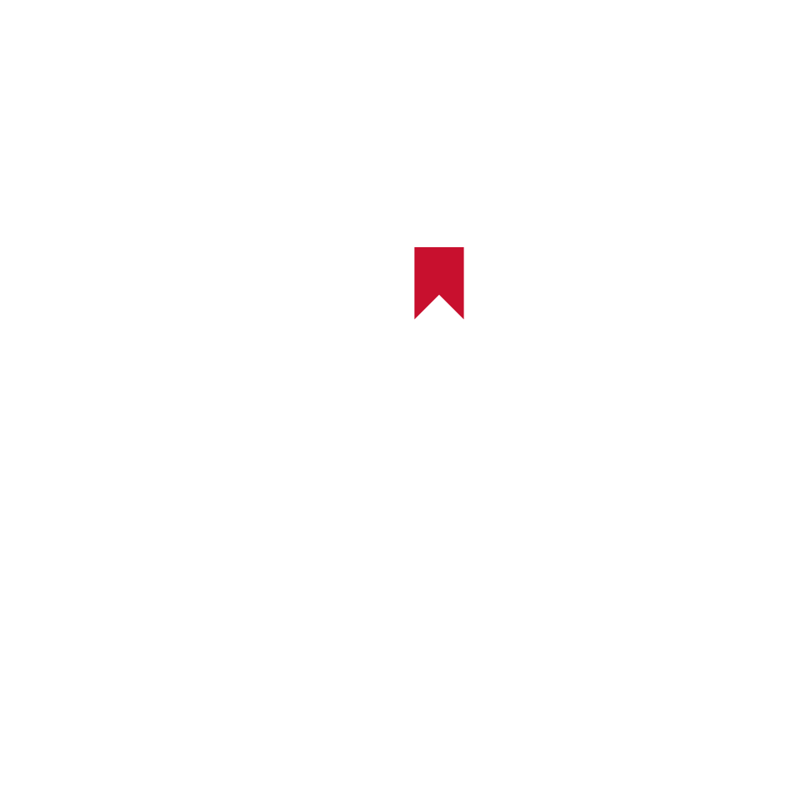
</a>

# Notes

**Organize your ideas easily.**

Simple notes that stay on your phone.

 

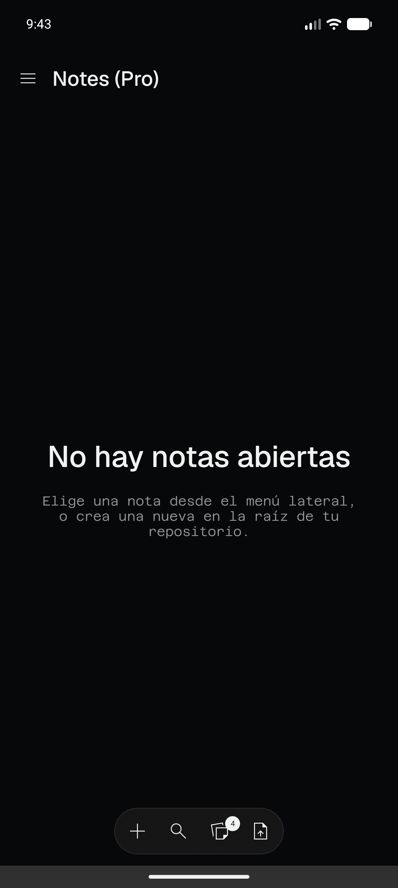
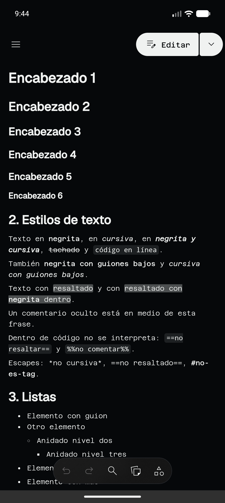
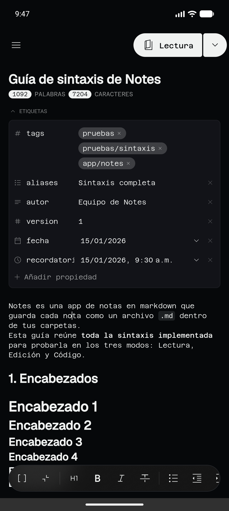
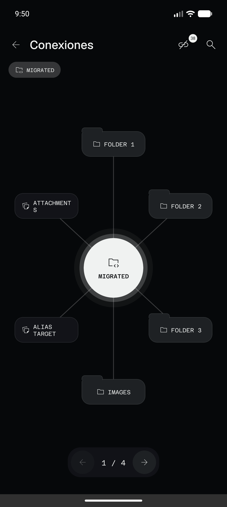

 

## Why Notes

- Your notes stay on your phone.
- Each note is a simple file in a folder you choose.
- Read, write or edit the text in one place.
- Clean and easy to use.

## Write

- Read a note, write with formatting, or edit the raw text.
- Add headings, lists, tasks, quotes and code.
- Add callouts, highlights and footnotes.
- Create tasks with your own states.
- Find and replace text in a note.
- Undo, redo and autosave.

 

## Tables

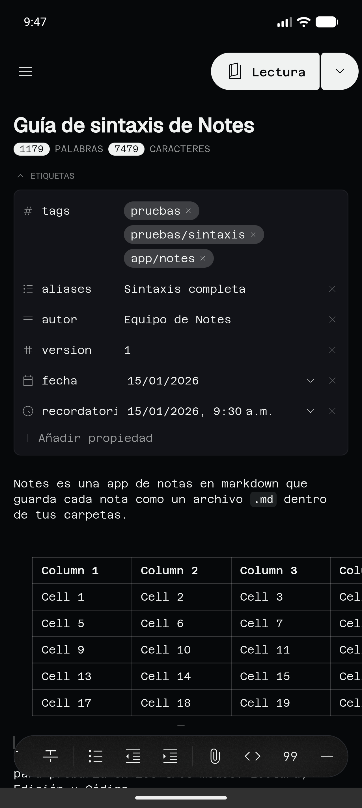

- Drag to choose the table size.
- Edit cells right in the table.
- Add, move, copy or delete rows and columns.
- Align each column.

 

## Properties

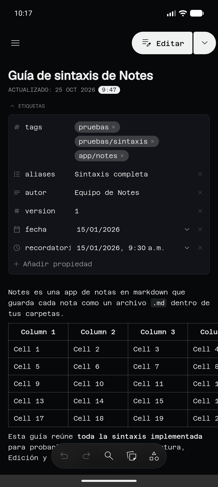

- Add tags, dates, lists, numbers and checkboxes to a note.
- Group tags like `work/projects`.
- Show or hide the panel.

 

## Link your ideas

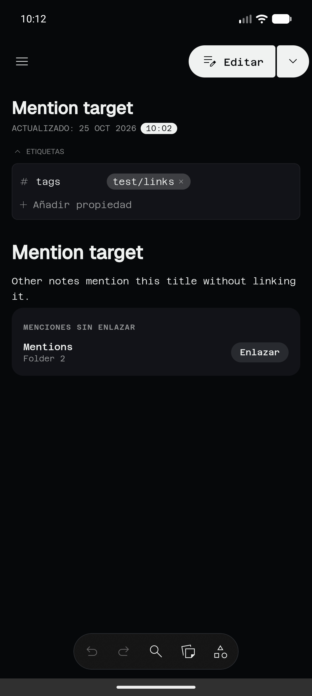

- Link notes with `[[double brackets]]`.
- Link to a heading or a paragraph.
- Show other notes inside a note.
- See which notes link to this one.
- Get suggestions for mentions without a link.
- Links update when you rename a note.

 

## Outline

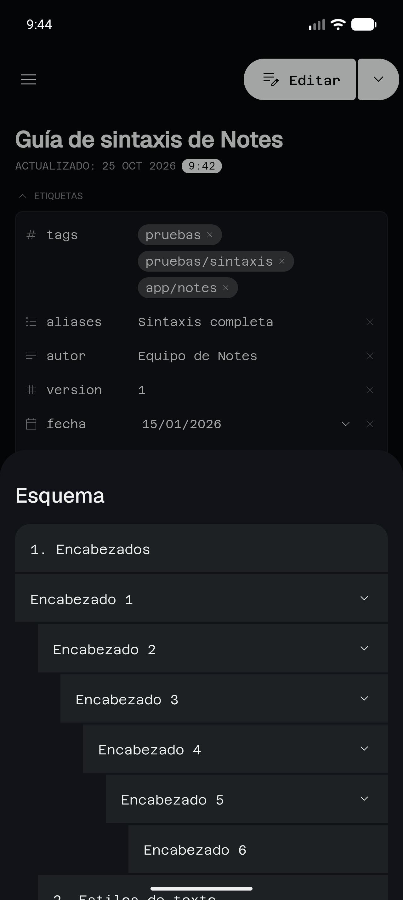

- See all headings of a note.
- Tap a heading to jump to it.
- See the notes it links to.

 

## Connections

- See your notes as a map.
- Start from a folder, note, tag or file.
- Tap a note to move through the map.
- Tap the center to see what is related.

 

## Pending

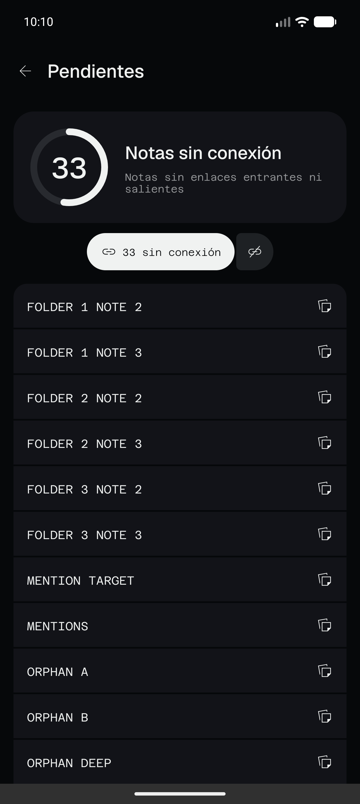

- Find notes with no links.
- Find broken links.
- Create a missing note in one tap.

 

## Search

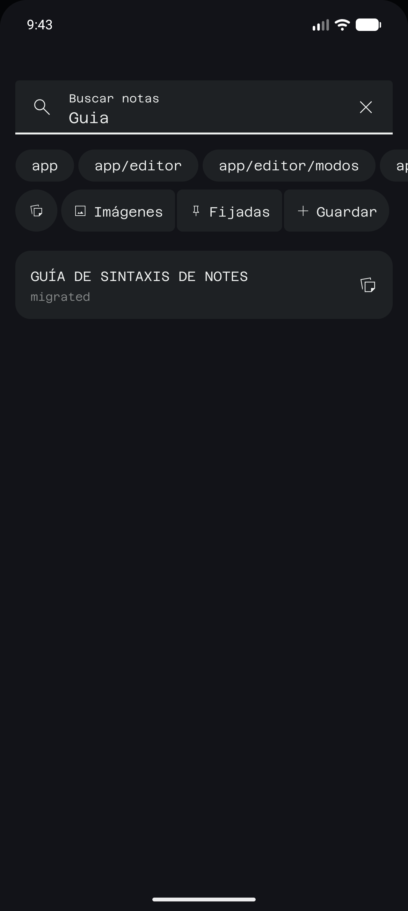

- Search by title or content.
- Filter by tag, folder, pinned or images.
- Save the searches you use often.
- See your recent searches.

 

## Organize

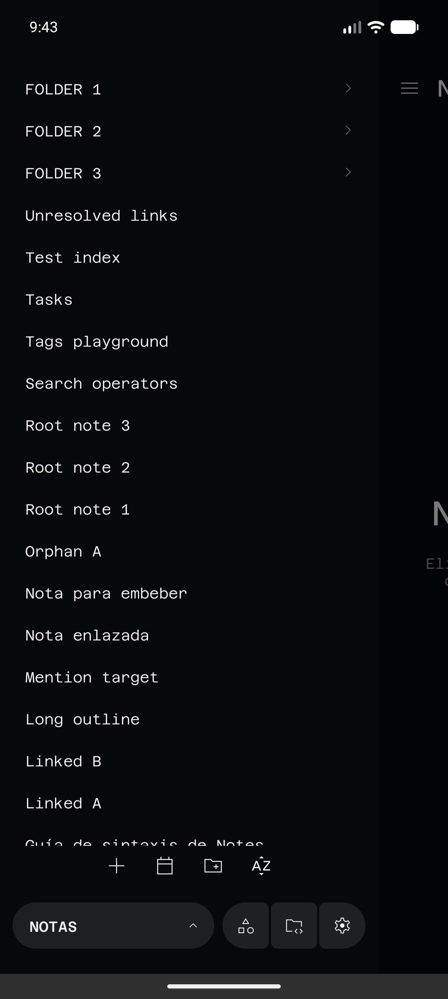

- Browse one folder at a time.
- Press and hold a folder to see its actions.
- Sort by name or date.
- Pin your favorite notes.
- Duplicate a note or move it to another folder.
- Use several folders, each with subfolders.

 

## Tags

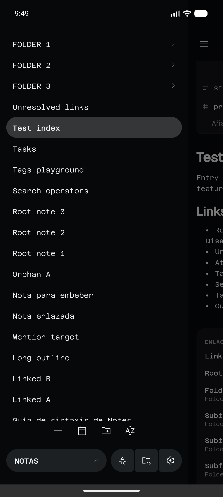

- Browse your notes by tag.
- Nested tags are grouped for you.

 

## Templates

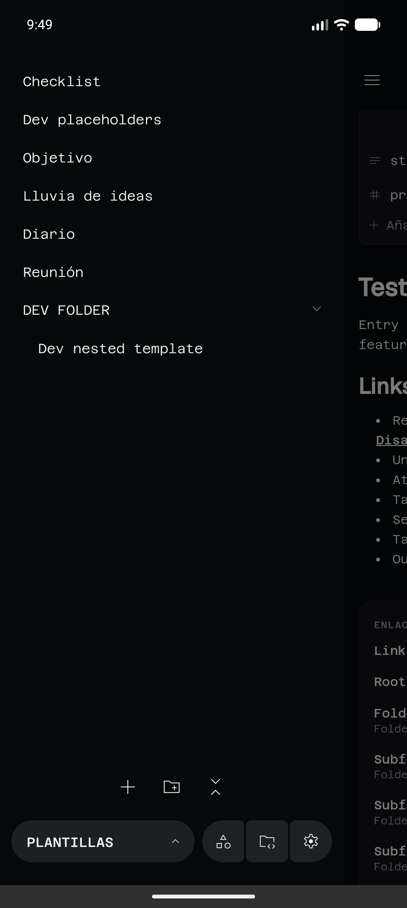

- Start a note from a template.
- Create your own templates.
- Fill in the date, time or title automatically.
- Open today's note in one tap.
- Choose the folder for new notes.

 

## Version history

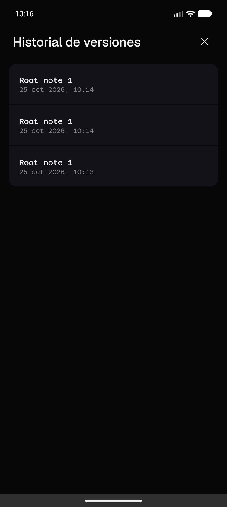

- Go back to an earlier version of a note.
- Compare changes before you restore.

 

## Share and export

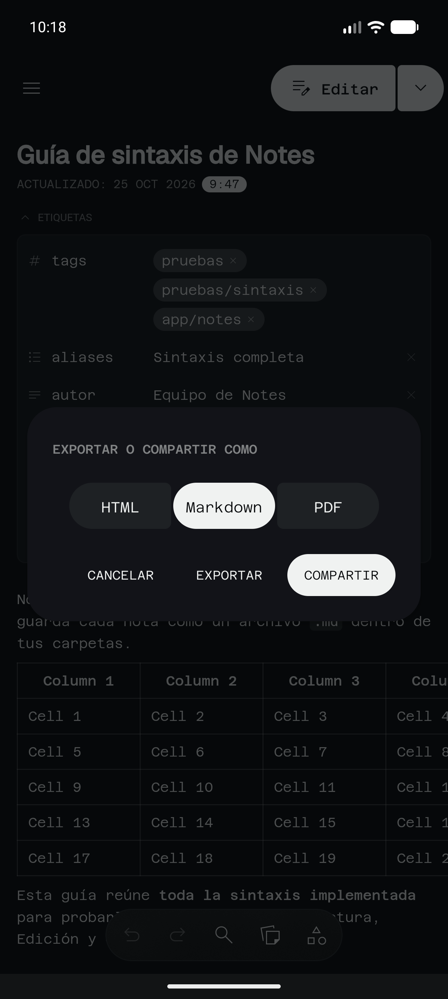

- Export or share as Markdown, HTML or PDF.
- Import the notes you already have.
- Open text files from other apps.
- Add images, audio, video and PDFs.
- Take a photo and add it to a note.

 

## Make it yours

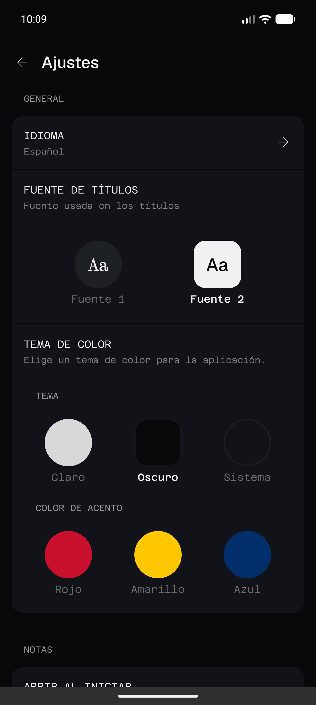

- Choose light, dark or your phone's theme.
- Pick an accent color.
- Pick a font for titles.
- Change the text size and width.
- Turn line numbers and spellcheck on or off.
- Use it in 15 languages.

 

## Free vs Pro

Notes is free. Pro unlocks more.

| Feature | Free | Pro |
| --- | --- | --- |
| Write, read and edit notes | ✓ | ✓ |
| Tables, tasks and callouts | ✓ | ✓ |
| Links, outline and connections | ✓ | ✓ |
| Search and saved searches | ✓ | ✓ |
| Tags and templates | ✓ | ✓ |
| Daily note | ✓ | ✓ |
| Import and Markdown export | ✓ | ✓ |
| Light and dark themes | ✓ | ✓ |
| 15 languages | ✓ | ✓ |
| Folders on your phone | 1 | Unlimited |
| Subfolders | 1 | Unlimited |
| Version history | Last 5 versions | All versions |
| Accent colors | White | All colors |
| HTML and PDF export | - | ✓ |

## Download

## Built with

   

## Contribute

1. Fork the repository and clone it.
2. Install with `npm install`.
3. Connect your Android phone with a USB cable.
4. Run `npx expo start`.
5. Make your changes and open a pull request.

## Translations

Help us bring Notes to your language on [Crowdin](https://crowdin.com/project/monospace-notes).
